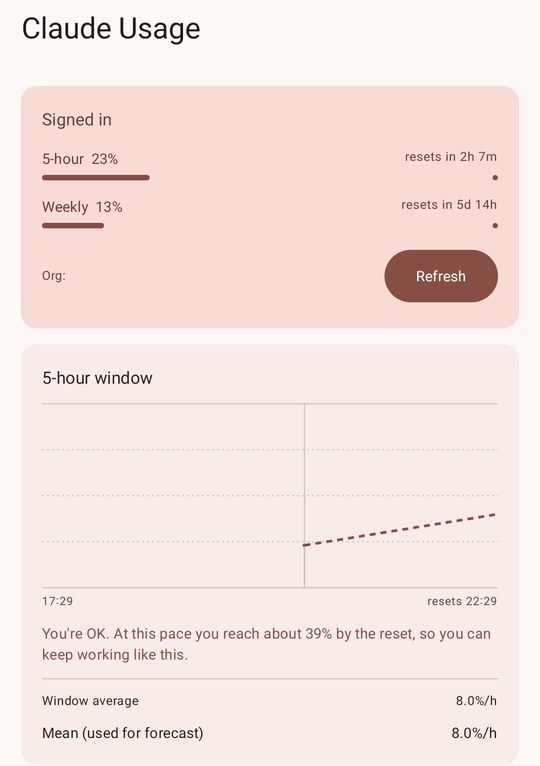
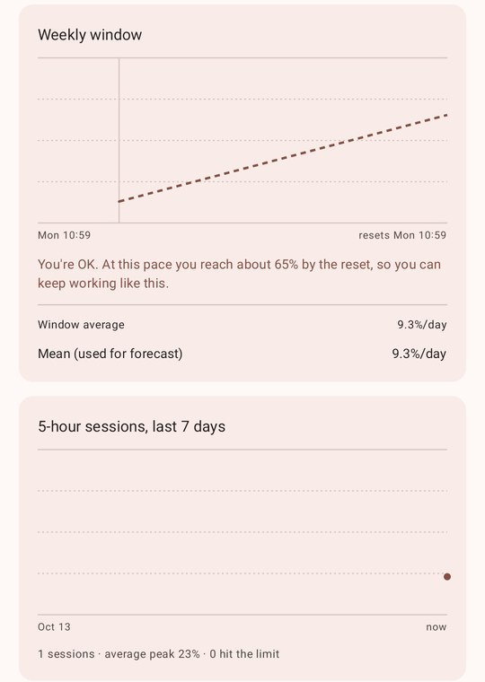
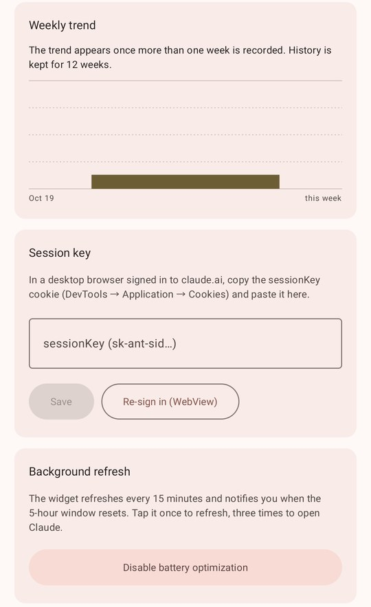
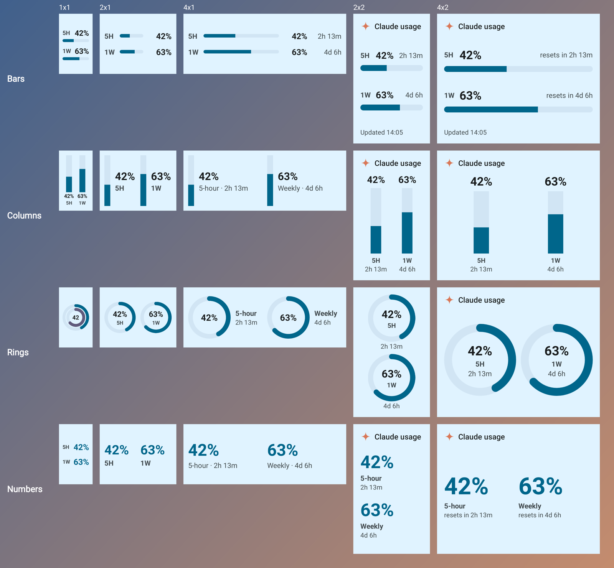

<h1 align="center">Claude Usage Widget</h1>

Android home-screen widget showing your Claude Pro/Max usage: the 5-hour and 1-week percentages and when each resets.

Maintained by [Matías Saavedra](https://github.com/matias-saavedra-g). Forked from [utaysi/claude-usage-widget](https://github.com/utaysi/claude-usage-widget) by [utaysi](https://github.com/utaysi).

  
  
  

## Changes in this fork

- Sign in by pasting your `sessionKey` cookie instead of using the in-app WebView login, which can fail on some phones.
- GitHub Actions builds the APK on every push and publishes each new version on `master` to [Releases](https://github.com/matias-saavedra-g/claude-usage-widget/releases).
- Tap the widget once to refresh, or three times quickly to open the Claude app.
- A notification tells you when the 5-hour window resets.
- Material 3 design that follows the system theme: light or dark, and wallpaper colors (Material You) on Android 12 or newer, in both the app and the widget.
- Usage tracker in the app: charts of the current 5-hour and weekly windows, every 5-hour session of the last 7 days, and peak usage per week. A forecast says whether you run out before the reset at your current pace, or that you are OK.
- Four widget styles (bars, columns, rings, numbers) that adapt from 1×1 to 5×3. Each widget can show both limits or just one, on a solid, translucent or transparent background.
- A four-point orange star replaces the lobster icon (source: `docs/logo.svg`).

## Requirements

- A Claude Pro or Max subscription. API-key usage is not shown.
- Android 8.0 or newer.

## Install

1. Download `claude-usage-widget-vX.Y.apk` from the [latest release](https://github.com/matias-saavedra-g/claude-usage-widget/releases/latest). Builds from other branches are in the [Actions](https://github.com/matias-saavedra-g/claude-usage-widget/actions) tab as the `claude-usage-widget` artifact (sign-in required).
2. Install the APK on your phone. Allow installs from unknown sources when asked.
3. If you have the original app installed, uninstall it first. The two are signed with different keys.
4. Builds from version 1.1 on are signed with the fixed key in `app/debug.keystore`, so later builds install as updates. A build older than 1.1 was signed with a random key, so uninstall it once before installing 1.1.

### Install and update with Obtainium

[Obtainium](https://github.com/ImranR98/Obtainium) installs the APK straight from GitHub Releases and notifies you of new versions. With Obtainium installed, tap:

Or open Obtainium, tap **Add app** and paste `https://github.com/matias-saavedra-g/claude-usage-widget` as the source URL.

## Setup

1. In a desktop browser signed in to [claude.ai](https://claude.ai), open DevTools → Application → Cookies → `https://claude.ai` and copy the value of `sessionKey` (starts with `sk-ant-sid`).
2. In the app, paste it, tap **Save session key**, then **Test fetch now**. The percentages should match [claude.ai/settings/usage](https://claude.ai/settings/usage).
3. Tap **Disable battery optimization** so Android does not stop the background refresh.
4. Allow notifications when asked. On Android 12 or newer, tap **Allow on-time reset notification** if it appears, so the reset notification is not delayed.
5. Add the **Claude Usage** widget to your home screen, or tap **Add widget to home screen** in the app. Tap it once to refresh, or three times quickly to open the Claude app (or claude.ai if the app is not installed).
6. To change its style, long-press the widget and open its settings (**Reconfigure** on Android 12 or newer). Resize it to show more or less detail.

The session key expires after a few weeks, or when you sign out of claude.ai in that browser. When the widget says to sign in, paste a new key.

## Widget sizes and styles

The widget drops in at 2×2 and resizes from 1×1 to about 5×3. It does not just scale up: each size gets its own layout, following Android's [widget quality guidelines](https://developer.android.com/design/ui/mobile/guides/widgets/widget_quality_guide). Small sizes show only the percentages. Larger sizes add labels, reset times, a header and the time of the last update. One-row widgets have a compact layout for landscape and a roomier one for portrait.

Long-press a widget and open its settings to choose, for that widget only:

| Setting | Options |
| --- | --- |
| Style | **Bars** (horizontal progress bars), **Columns** (vertical bars, good for tall widgets), **Rings** (circular gauges), **Numbers** (large percentages, no graphics) |
| Show | 5-hour and weekly, 5-hour only, or weekly only. One limit leaves more room for it on a 1×1 widget. |
| Background | Solid, translucent (wallpaper shows through), or none |

The settings screen has a live preview at several sizes. Every style follows the system light or dark theme and, on Android 12 or newer, the wallpaper colors and the launcher's corner radius. A limit at 90% or more turns red. Widgets placed before version 1.5 keep the bars style until you change it.

## How it works

The app calls `claude.ai/api/organizations/{orgId}/usage`, the same undocumented endpoint the claude.ai usage page uses, with your `sessionKey` cookie. It finds your organization ID on its own. When Cloudflare blocks a request, the app loads claude.ai in a hidden WebView to get a new `cf_clearance` cookie and retries. A background job refreshes every 15 minutes. After each fetch the app sets an alarm for the 5-hour reset time and posts a notification when it fires. If the alarm was lost, for example after a reboot, the next refresh sends the notification instead.

An amber dot on the widget means the data is out of date.

Every successful fetch is also appended to a small history file (about 400 KB for 12 weeks). The app keeps 12 weeks of history and moves older rows to an archive file. The forecast computes a burn rate with up to four methods and uses their mean: usage so far over time since the window opened, the least-squares trend over the last hour (5-hour) or day (weekly), an exponentially smoothed rate between fetches, and the average rate of past windows. Methods without enough data are skipped.

Anthropic does not support this. It may stop working if the endpoint or Cloudflare setup changes.

## Security

The session key gives full access to your Claude account. The app stores it with `EncryptedSharedPreferences` and excludes it from backups. Never put it in the source code or share it.

## Releases

On every push to `master`, the **Build APK** workflow reads `versionName` from `app/build.gradle.kts`. If no tag `v<versionName>` exists yet, it creates that tag and a GitHub release with the APK attached. To publish a new version, raise `versionCode` and `versionName` and push to `master`. Pushes that keep the same version only update the Actions artifact.

## Build locally

Requires JDK 17 and the Android SDK with platform 36.

1. Create `local.properties` in the project root with `sdk.dir=/path/to/Android/Sdk`.
2. Run `./gradlew :app:assembleDebug`.
3. Install with `adb install -r app/build/outputs/apk/debug/app-debug.apk`.

`./gradlew :app:testDebugUnitTest` renders every widget style at common launcher sizes, in light and dark theme, with Robolectric (no emulator needed). It fails if any text is cut off, and writes contact sheets to `app/build/widget-renders/`.

| Path | Contents |
| --- | --- |
| `data/` | Usage history and forecasts, endpoints, encrypted storage, cookie handling, Cloudflare retry, fetch logic |
| `auth/LoginActivity.kt` | WebView login |
| `ui/MainActivity.kt` | Main screen: usage, refresh, session key entry |
| `ui/UsageInsights.kt`, `ui/UsageCharts.kt` | Forecast cards and charts |
| `widget/` | Widget layouts and styles (`WidgetStyles.kt`), size classes (`UsageGlanceUi.kt`), per-widget settings and the settings screen (`WidgetConfig*.kt`) |
| `work/` | Background refresh |
| `notify/` | 5-hour reset alarm and notification |
